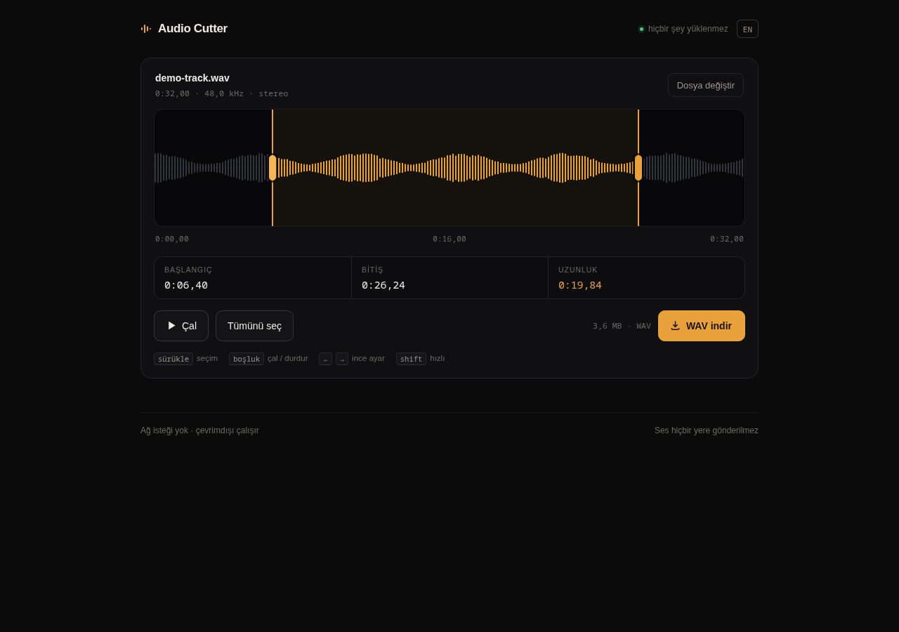
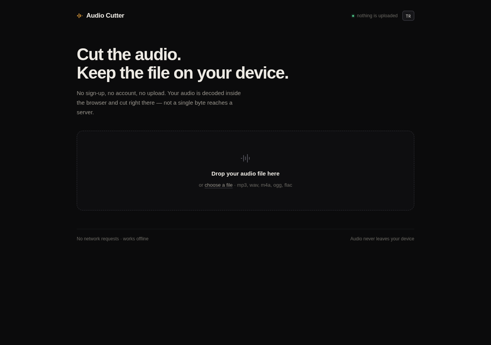

# Audio Cutter — Free Online Audio Trimmer and WAV Cutter

[](https://toprakpt1.github.io/Audio-Cutter/)
[](LICENSE)
[](https://github.com/toprakpt1/Audio-Cutter/stargazers)
[](https://react.dev)
[](https://vite.dev)
[](#privacy-and-security)
[](#supported-formats)
[](#privacy-and-security)
[](#contributing)

**Cut audio in your browser without uploading it.** Audio Cutter is a free, privacy-first online audio trimmer for MP3, WAV, M4A, OGG and FLAC files. Drag a file onto the page, select the part you want to keep on the waveform, preview the selection, and download a lossless 16-bit WAV — all on your own device.

**Live demo:** [toprakpt1.github.io/Audio-Cutter](https://toprakpt1.github.io/Audio-Cutter/)

[](docs/screenshots/editor-tr.png)

## What Is Audio Cutter?

Audio Cutter is a browser-based audio editor built for one job: trimming audio quickly. It uses the Web Audio API to decode files and Canvas to draw the waveform. There is no backend, no account system, and no upload step, so decoding, cutting and WAV encoding all happen inside the browser tab.

The app is useful for cutting a song, trimming a voice recording, removing silence from the start or end of a clip, extracting a short sound effect, or preparing audio for a video edit. Because the file never leaves the device, it also works for recordings you would not want to send to a third-party server.

## Why Use Audio Cutter?

- **No uploads:** Files are processed locally and are never sent to a server.
- **No account:** Open the page and start cutting; no sign-up or email required.
- **Lossless export:** The trimmed result is saved as uncompressed 16-bit PCM WAV.
- **Visual editing:** Select a range directly on the waveform, or drag the selection to move it.
- **Precise controls:** Arrow-key nudging moves selection edges by 20 ms or 500 ms.
- **Instant preview:** Play only the selected range before downloading.
- **Works offline:** After the first load, the app makes no network requests.
- **Responsive:** Pointer events and touch support make the editor usable on phones and tablets.
- **Free and open source:** MIT licensed, with no ads, analytics or tracking.

## Features

| Feature | Description |
| --- | --- |
| Drag and drop | Drop an audio file anywhere on the page. |
| File picker | Choose a file from the device with the built-in browser dialog. |
| Clipboard paste | Paste an audio file from the clipboard with `Ctrl+V` or `Cmd+V`. |
| Waveform view | Canvas-based peak rendering with the selected range highlighted. |
| Range selection | Drag across the waveform to create a selection. |
| Move selection | Drag inside the selection to shift it without changing its length. |
| Fine tuning | Drag the start and end handles, or nudge them with the arrow keys. |
| Selection preview | Play or pause the current selection with `Space`. |
| WAV export | Download the selected range as 16-bit PCM WAV. |
| Size estimate | See the expected WAV file size before downloading. |
| Bilingual interface | Switch between Turkish and English; the choice is remembered locally. |
| Keyboard and screen reader support | Sliders expose ARIA labels and value text. |

## Screenshots

### Turkish Interface


### English Interface



### Waveform Editor


## Quick Start

### Requirements

- **Node.js** 20.19+ or 22.12+ (required by Vite 8)
- **npm** 10+ (or yarn, pnpm, bun)
- A modern browser with Web Audio API support

### Run Locally

```bash
git clone https://github.com/toprakpt1/Audio-Cutter.git
cd Audio-Cutter
npm install
npm run dev
```

The development server starts at `http://localhost:5173`.

### Production Build

```bash
npm run build
npm run preview
```

The `dist/` folder contains a static build that can be hosted on GitHub Pages, Netlify, Vercel, Cloudflare Pages, nginx, or any other static file server. No backend is required.

## How to Use

1. Open the app in a browser.
2. Add an audio file by dragging and dropping it, clicking the upload area, or pasting it from the clipboard.
3. Drag across the waveform to select the part you want to keep.
4. Drag inside the selection to move it, or drag the handles to adjust the start and end points.
5. Press `Space` or click **Play** to preview the selection.
6. Click **Download WAV** to save the trimmed audio. The file is named `<original-name>-cutter.wav`.

### Keyboard Shortcuts

| Shortcut | Action |
| --- | --- |
| `Space` | Play or pause the selection preview |
| `Arrow Left` / `Arrow Right` | Nudge the focused handle by 20 ms |
| `Shift` + `Arrow Left` / `Arrow Right` | Nudge the focused handle by 500 ms |
| `Home` | Jump the focused handle to the start of the track or selection |
| `End` | Jump the focused handle to the end of the track |
| `Ctrl+V` / `Cmd+V` | Paste an audio file from the clipboard |

## Supported Formats

| Direction | Formats |
| --- | --- |
| Input | `mp3`, `wav`, `m4a`, `ogg`, `oga`, `flac`, `aac`, `opus`, `webm`, `aiff` |
| Output | `wav` — 16-bit PCM, little-endian |

Input support ultimately depends on the codecs available in the browser's Web Audio API implementation. Chrome, Edge, Firefox and Safari can decode the common formats listed above, but support for individual codecs may vary by browser and operating system.

The exported WAV keeps the channel layout and sample rate of the decoded audio. Some browsers resample input to the device's `AudioContext` sample rate during decoding, so the exported file may use that rate rather than the original file's rate.

## Privacy and Security

Audio Cutter is designed around local processing.

- **No file uploads:** The audio file is read with the File API and decoded in memory. No audio data is sent anywhere.
- **No accounts:** There is no login, email capture, or user database.
- **No analytics or telemetry:** The project includes no tracking scripts and no advertising code.
- **No cookies:** The only stored preference is the interface language, kept in `localStorage`.
- **No external CDN:** React and all application code are bundled into the static build.
- **No network requests after load:** Once the app is loaded, cutting and exporting work entirely offline.
- **Open source:** The full implementation is available in this repository under the MIT license.

You can verify the offline claim by opening the browser developer tools, switching the network tab to offline mode, and continuing to trim and export audio.

## How It Works

| Step | Technology |
| --- | --- |
| File input | File API, drag and drop events, clipboard events |
| Audio decoding | `AudioContext.decodeAudioData` (Web Audio API) |
| Waveform rendering | HTML5 Canvas 2D with peak detection |
| Selection | Pointer events, keyboard events and ARIA sliders |
| Preview playback | `AudioBufferSourceNode` |
| WAV encoding | `DataView` with 16-bit PCM samples |
| Download | `Blob` and `URL.createObjectURL` |

### Data Flow

1. **Load:** File → `ArrayBuffer` → `decodeAudioData` → `AudioBuffer`
2. **Render:** `AudioBuffer` → peak detection → Canvas waveform
3. **Select:** User input → selection state (`start`, `end`)
4. **Preview:** Selection → `AudioBufferSourceNode` playback
5. **Export:** `AudioBuffer` → trim to selection → 16-bit PCM → WAV `Blob` → download

## Frequently Asked Questions

### Is Audio Cutter free?

Yes. The app is free to use, has no ads, and is released under the MIT license.

### Does Audio Cutter upload my audio files?

No. Audio is decoded and edited in the browser tab. The project has no backend and makes no network requests after the page loads.

### Can I cut MP3 files online without installing software?

Yes. Open the app, load an MP3 file, select a range on the waveform, and download the result. No installation or account is needed.

### What audio formats can I import?

MP3, WAV, M4A, OGG, OGA, FLAC, AAC, Opus, WebM and AIFF, as long as the browser can decode them.

### What format does Audio Cutter export?

It exports 16-bit PCM WAV. Other output formats such as MP3, AAC or FLAC are intentionally not supported to keep the tool dependency-free and fully offline.

### Can I use Audio Cutter offline?

Yes. After the page has loaded once, the app works without a network connection. You can also self-host the `dist/` folder on a local server.

### Is there a file size limit?

There is no hard-coded limit. Very large files use more browser memory, so the practical limit depends on the device. Files up to several hundred megabytes usually work on modern computers.

### Does Audio Cutter work on mobile?

Yes. The interface uses pointer events and touch-friendly controls. On very large files, desktop browsers generally provide more memory and a smoother experience.

### Do I need to create an account?

No. There is no sign-up, login, email capture or user profile.

## Tech Stack

| Layer | Technology |
| --- | --- |
| UI | React 19 |
| Build tool | Vite 8 |
| Audio | Web Audio API |
| Waveform | Canvas 2D |
| Export | 16-bit PCM WAV encoder written in JavaScript |
| Styling | Plain CSS with a dark theme |
| Runtime dependencies | None beyond the bundled React application |

## Development

### Project Structure

```text
Audio-Cutter/
├── docs/
│   └── screenshots/       # README screenshots
├── public/
│   ├── og-image.png       # Social sharing image
│   └── robots.txt
├── src/
│   ├── components/
│   │   └── Waveform.jsx   # Canvas waveform and selection handles
│   ├── lib/
│   │   ├── format.js      # Number, size and time formatting
│   │   ├── i18n.js        # Turkish and English messages
│   │   ├── peaks.js       # Peak detection
│   │   └── wav.js         # WAV encoder
│   ├── App.jsx            # Main application component
│   ├── main.jsx           # React entry point
│   └── styles.css         # Global styles
├── index.html             # HTML shell and meta tags
├── package.json
├── vite.config.js
└── README.md
```

### Available Scripts

| Script | Description |
| --- | --- |
| `npm run dev` | Start the Vite development server on port 5173 |
| `npm run build` | Build the production bundle into `dist/` |
| `npm run preview` | Preview the production build locally |

### Adding a Language

1. Add the language code to the `LANGUAGES` array in `src/lib/i18n.js`.
2. Add a translated message object for the new language.
3. Update the language toggle in `src/App.jsx` if the interface should support more than two languages.

## Limitations

- **Single output format:** Only 16-bit PCM WAV is supported; there is no MP3 or FLAC export.
- **Memory-bound file sizes:** Large files are limited by browser memory rather than an explicit upload cap.
- **Trimming only:** The editor does not provide fades, normalization, effects, multitrack editing or noise removal.
- **Codec support varies:** The browser must be able to decode the input format.
- **Browser requirements:** A current browser with Web Audio API and Canvas support is required.

## Contributing

Contributions are welcome. Useful directions include:

- MP3, FLAC or AAC export via a bundled encoder
- Fade-in and fade-out controls
- Loop playback for the selected range
- Waveform zoom and horizontal scrolling
- Loudness and clipping indicators
- Additional interface languages
- Automated tests for the WAV encoder and peak detection
- Accessibility and mobile UX improvements

Open an issue or submit a pull request on [GitHub](https://github.com/toprakpt1/Audio-Cutter).

## License

MIT © [toprakpt1](https://github.com/toprakpt1)

See [LICENSE](LICENSE) for the full text.
